<picture>
  <source media="(prefers-color-scheme: dark)" srcset="assets/terminal-dark.svg">
  
</picture>

Specialist AI Engineer at Biopeak Health. I built Luma: an AI clinical co-pilot, one live view of a patient's full diagnostic history (20+ report types), built and shipped solo into daily clinical use.

### `> what have you shipped?`

`● ls ~/shipped`

- [`playdeck`](https://mishrakushal.github.io/playdeck/) · my live side projects, pasted up as two-ink riso posters. Every poster is a working deployment.
- [`cc-helper`](https://cc-helper.vercel.app/) · drops CLAUDE.md, DESIGN.md and EXAMPLES.md into a new project, so the rules show up before the code does.
- [`chat-cards`](https://github.com/mishrakushal/claude-improvements) · draws your prompts and Claude's text replies as rounded cards in the Claude Code terminal transcript.
- [`find-me-a-place`](https://find-me-a-place-liart.vercel.app/) · somewhere to meet that's fair to the whole group. Places are ranked by how evenly everyone's travel time is spread, not by the midpoint (the midpoint is usually a lake).

<code>+3 more</code>

- [`fib-me`](https://fib-me.vercel.app/) · everyone writes a lie for a weird true fact, then tries to find the real answer among the lies.
- [`imposter`](https://imposter-teal-eight.vercel.app/) · everyone gets the secret word except the imposter, who gets the category and a lot of confidence.
- [`vitruvian-pokemon`](https://vitruvian-sigma.vercel.app/#25) · Leonardo never met a Pikachu. Every Pokémon's real 3D model, measured from its own mesh and bones and drawn into his notebook.

### `> how do you work?`

`● cat notebook.md`

> I try to get it out of my head instead of trying to sort it in my head.

0. **Out of my head.** Ideas, edge cases, short- and long-term goals, on paper first.
1. **Decompose.** Break it down.
2. **Design.** Draw the system.
3. **Build.** Write the code myself.
4. **Ship.** Good enough, and deployed.
5. **Observe.** Watch it.

Back to 0: building (and breaking and re-building).

**A good enough solution which is deployed is always better than the perfect solution sitting on your local.** 
↳ Five Playdeck projects are live. Find Me A Place runs at ₹0 on free tiers.

**Observability is a powerful weapon.** 
↳ Sentry catches every route failure in Find Me A Place, and rate limits answer 429 with a Retry-After.

**I care about the edge cases nobody sees.** 
↳ Fib-Me dedupes lies by NFKD-normalised text. Find Me A Place's Weiszfeld variant never divides by zero when the answer lands on someone's front door.

<code>&gt; show me your model card</code>

**trained on** · BITS Pilani, BE Computer Science (2020–24) · JPMorgan Chase (2024–25) · Biopeak Health (2025–)

**known limitations** · "I wasn't a topper, but I was always curious and willing to get my hands dirty."

| eval | result |
| --- | --- |
| weekly report generation, JPMorgan Chase 2024 | 94.44% faster |
| report types in one patient record, Luma | 20+ |
| tests, Find Me A Place | 102 in 18 files |
| divide-by-zero when the answer is someone's front door | 0 |

<code>&gt; what have you written?</code>

- [How Agentic Coding is rewriting Software Engineering Principles](https://mishrakushal.medium.com/how-agentic-coding-is-rewriting-software-engineering-principles-b5312ce5f15a) · Medium, Apr 2026
- [HealthRec-Chain: Patient-centric blockchain enabled IPFS for privacy preserving scalable health data](https://doi.org/10.1016/j.comnet.2024.110223) · Computer Networks, vol. 241, 2024

### `> what do you build with?`

`● which kushal`

Python · FastAPI · RAG · LLM routing · Next.js · Claude Code

### `> where can I find you?`

`● open`

[LinkedIn](https://www.linkedin.com/in/kushal-mishra) · [Medium](https://medium.com/@mishrakushal) · [mishrakushal.github.io](https://mishrakushal.github.io/)
